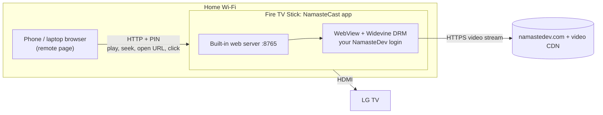

# NamasteCast

Watch your NamasteDev courses on the big screen (Fire TV Stick on your LG TV), with your phone or laptop as the remote. Works like Netflix's "cast" button, not like screen mirroring.

## Why mirroring gave you audio but no video

Course platforms usually protect their video with DRM (Widevine on Android and Chrome, FairPlay on Apple). DRM blocks the video layer from being captured or mirrored, and audio often still gets through. That matches what you saw with AirPlay mirroring. I could not confirm which player NamasteDev uses, but a home-made screen-share app would hit the same black screen for the same reason.

So NamasteCast doesn't stream your phone's screen. **The TV plays the course itself**, logged into your own NamasteDev account, the way the Netflix app on a TV does. Your phone only sends commands.



The video never touches your phone, so nothing gets captured and DRM has nothing to block.

## Setup (about 10 minutes, once)

### 1. Allow sideloading on the Fire Stick
1. Home > **Find** > search **Downloader** (by AFTVnews) > install it.
2. **Settings > My Fire TV > About**. Click the device name 7 times until it says you're a developer.
3. **Settings > My Fire TV > Developer options > Install unknown apps** > turn **Downloader** on.

Fire OS menu labels change between versions, so yours may read slightly differently.

### 2. Install the app
In Downloader, type this URL (it's long, so do it once):

```
https://raw.githubusercontent.com/AzharShaikhSE/NodeJS-projects/claude/zealous-tesla-gvq2j4/NamasteCast/dist/NamasteCast.apk
```

**Shorter option:** on your laptop (same Wi-Fi), run:
```bash
cd NamasteCast/dev-server && npm run share-apk
```
It prints something like `http://192.168.1.20:8000/a`. Type that into Downloader instead.

Install it, then open **NamasteCast** from Your Apps (long-press Home > Apps if it isn't on the home row).

### 3. Pair your phone
The TV shows a card with a **QR code**, an address like `192.168.1.42:8765`, and a **4-digit PIN**.
- Phone: scan the QR with the camera. You're paired, no typing needed.
- Laptop: open `http://192.168.1.42:8765`, enter the PIN.
- Tip: on iPhone, Share > **Add to Home Screen** turns it into an app icon.

Press **menu (three lines)** on the Fire remote any time to bring the card back.

### 4. Log in to NamasteDev on the TV (once)
1. On the phone remote, use the **Touchpad** to move the TV pointer onto the login field, then tap.
2. Use **Type on TV** to send your email, password or OTP.
3. Cookies persist, so you stay logged in.

## Daily use

| You want to | Do this |
|---|---|
| Start a lesson | Paste the lesson link into **Play a course page on TV**, or tap one under **Recent** |
| Send a lesson from your laptop | Drag the **Play on TV** bookmarklet to your bookmarks bar, then click it on any lesson page |
| Fill the screen with the video | **TV mode** (works even when the player is locked down) |
| Play/pause, ±10s, speed, mute | Big buttons on the remote, or the Fire remote's play/pause, rewind and fast-forward keys |
| Click anything on the TV | Drag on the touchpad, then tap. Two fingers scroll |
| Use only the Fire remote | Arrows move the pointer (hold to go faster), OK clicks, Back goes back |
| Laptop shortcuts | `space` play/pause, `←` `→` 10s, `T` TV mode, `↑` `↓` scroll |

## What's in here

```
NamasteCast/
├── dist/NamasteCast.apk          signed, ready to sideload (v1.0.0)
├── firetv-app/                   Android TV app (Kotlin, no AndroidX, 0.9 MB)
│   └── app/src/main/
│       ├── java/.../MainActivity.kt   WebView, DRM permission, pointer, fullscreen, Fire remote keys
│       ├── java/.../RemoteServer.kt   LAN HTTP API (NanoHTTPD), PIN auth, lockout
│       ├── java/.../Commands.kt       command parsing + URL allow-listing (unit tested)
│       ├── assets/remote.html         the phone/laptop remote (served by the TV)
│       └── assets/tv-helper.js        injected into pages: video control, TV mode, scroll
└── dev-server/                   Node mock of the TV API + tests
    ├── server.js                 `npm start` -> work on remote.html on your laptop, no TV needed
    ├── share-apk.js              `npm run share-apk` -> short install URL
    └── test/                     node:test + Playwright e2e
```

## How it's built (and the trade-offs)

- **Server lives on the TV.** No cloud, no laptop needed, no account. It costs $0/month. The trade-off is that phone and TV must be on the same Wi-Fi. A cloud relay would let you control it from anywhere, but it would cost roughly $5/month for a small VM and add a point of failure. Not worth it for a couch remote.
- **Plain WebView over a custom player.** NamasteDev's own site does the playing, so login, progress tracking and DRM behave exactly as on desktop. The cost is that we can't script a player inside a cross-origin iframe. For that case the app sends real taps and key presses to the player, like a person would. Exact speed and seek-to-position only work when the video sits in the main page.
- **Desktop site by default.** It gives the full course layout on a 1080p TV. You can switch to the mobile site under TV settings.
- **Security.** LAN-only HTTP, 4-digit PIN (header or query), 10 wrong PINs lock the API for 60s. The API sends no CORS headers, so other websites can't read it. Only `http(s)` URLs can be opened, never `javascript:`, `file:` or `intent:`. The WebView gets the DRM permission only, never camera or mic. Known gap: traffic on your home Wi-Fi is plain HTTP, so anyone already on your network could sniff the PIN. Acceptable for a home TV. Don't run it on shared or public Wi-Fi.
- **Signing key is committed** (`firetv-app/keystore`, password `namastecast`). Every build, here or in CI or on your laptop, can install over the previous one. The catch: since the repo is public, anyone could sign an APK that installs as an update to this app. That only matters if you sideload an APK from someone else. Only install from this repo.

## Testing

| Layer | How | Result on this build |
|---|---|---|
| Command parsing, URL safety | JUnit, `./gradlew testDebugUnitTest` | 10/10 pass |
| HTTP server: PIN, lockout, endpoints | JUnit with a real socket | 7/7 pass |
| Mock API contract | `npm test` | 1/1 pass |
| Phone + laptop remote UI | Playwright, iPhone 13 + 1280px desktop | 7/7 pass |
| Video helper on real `<video>` (inline + cross-origin iframe) | Playwright, Chromium | 3/3 pass |
| Release build | `assembleRelease` + lint + apksigner verify | pass |

CI (`.github/workflows/namastecast.yml`) runs all of this on every push and uploads the APK as an artifact.

**Not tested:** on real Fire TV hardware, and against NamasteDev itself (no emulator support in the build box, and I don't have your login). Those are the first things to check. See below.

## If something's off

| Symptom | Likely cause / fix |
|---|---|
| Phone says "TV not reachable" | Phone on a different Wi-Fi (guest network, 5 GHz isolation, VPN on). Put both on the same network and turn off the VPN |
| Black video with audio, on the TV itself | The course needs a DRM level the Fire TV WebView doesn't offer. Try **Mobile site** in TV settings. If it's still black, use the Silk browser on the Fire TV as a fallback and tell me what you see |
| "Sign in with Google" is blocked | Google blocks some embedded browsers. Use email/OTP login, or try toggling Desktop/Mobile site |
| Lesson won't play until you click | Autoplay rules. Press **Play** once, or tap the player with the touchpad |
| Play/pause does nothing | The player is in a protected iframe. Move the pointer onto the video and **Click**, or use **TV mode** then **Click** |
| Too small or too big on TV | **Zoom −/+** in TV settings |
| Forgot PIN | Fire remote **menu** button shows it |

## Developing

```bash
# Remote UI with hot reload-ish loop (edit remote.html, refresh)
cd NamasteCast/dev-server && npm start          # http://localhost:8765/?pin=1234
npm test && npm run e2e                          # e2e needs Playwright + Chromium

# TV app
cd NamasteCast/firetv-app && ./gradlew testDebugUnitTest assembleRelease
adb connect <fire-tv-ip>:5555 && adb install -r app/build/outputs/apk/release/app-release.apk
adb shell am start -d https://namastedev.com com.namastecast.tv/.MainActivity
```

Needs JDK 17 and the Android SDK (platform 34). `local.properties` with `sdk.dir=...` or `ANDROID_HOME` set.
